# Fabricación láser

**Autor:** Frida Velazquez Anaya

**Fecha:** Jueves 22 de octubre de 2026

## Material

- Material: MDF de 3 mm.
- Espesor medido: entre 2.9 mm y 3.1 mm.
- Espesor de trabajo: 3.0 mm.

## Diseño

Se diseñó una caja abierta de cinco caras con juntas de dedos y una tira para comprobar el kerf del láser.

- Frente y parte trasera: 80 × 60 mm.
- Laterales: 50 × 60 mm.
- Base: 80 × 50 mm.
- Separación entre piezas: 3 mm.

Los archivos utilizados para el diseño son:

- [Diseño de la caja en DXF](Proyecto_ING2_corregido.dxf).
- [Tira de prueba de kerf en DXF](kerf.dxf).

## Prueba de kerf

- Espesor del material: 3.0 mm.
- Kerf medido: 0.112 mm.
- Ancho de ranura calculado: 2.888 mm.

La ranura se calculó restando el kerf al espesor del material:

ranura = espesor - kerf
3.0 mm - 0.112 mm = 2.888 mm

El valor del kerf se obtuvo mediante la tira de prueba y se utilizó para ajustar las ranuras de las uniones de la caja.

## Parámetros de corte

- Potencia: Max 70, Min 65.
- Velocidad: 30mm/s.
- Número de pasadas: 1

## Evidencia de fabricación

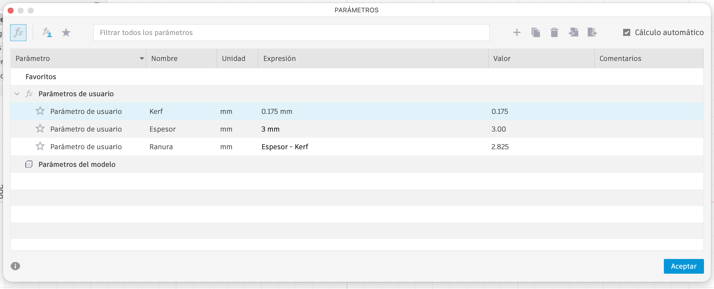

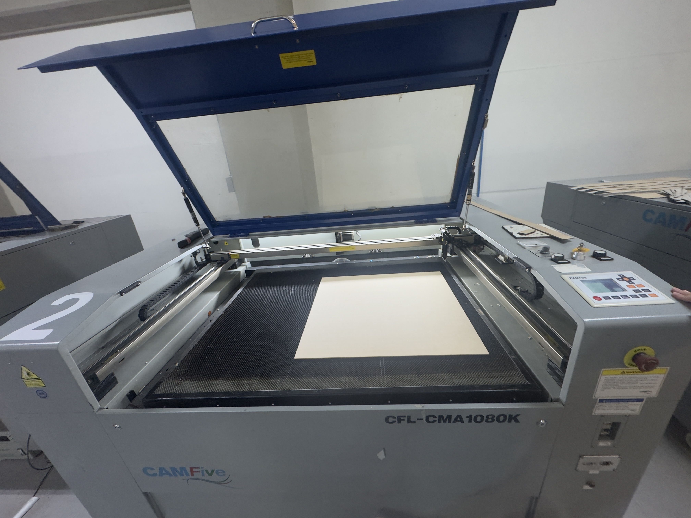

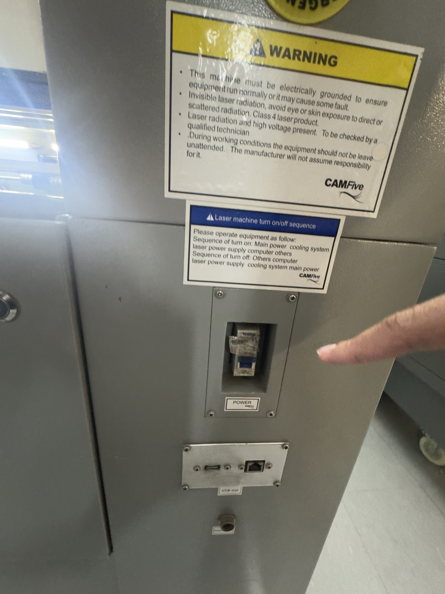

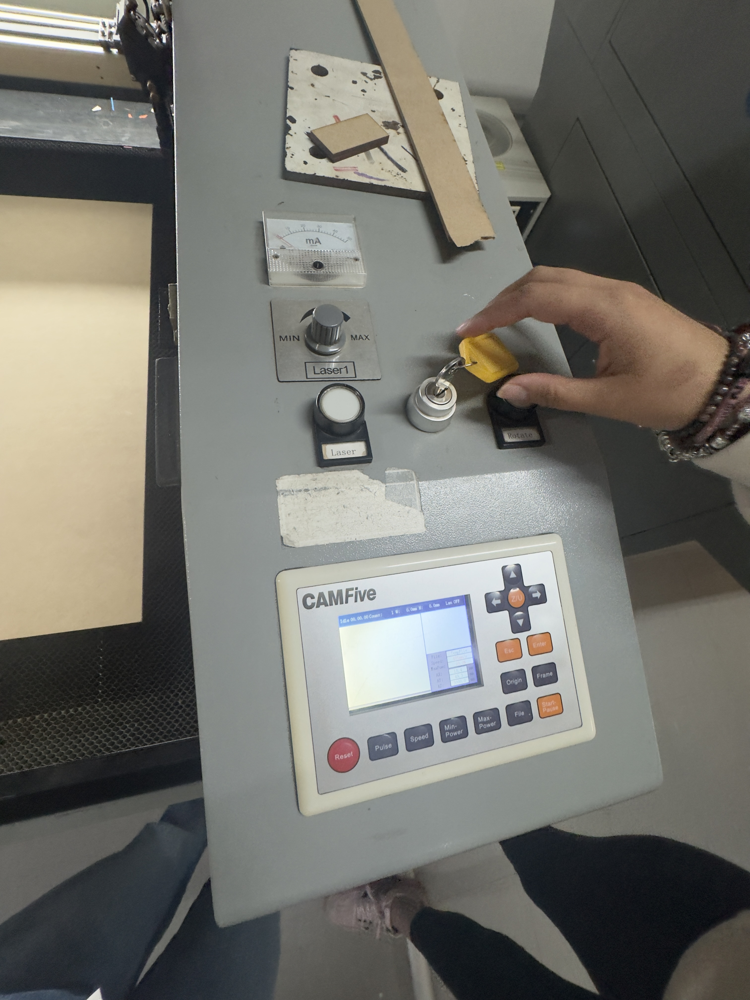

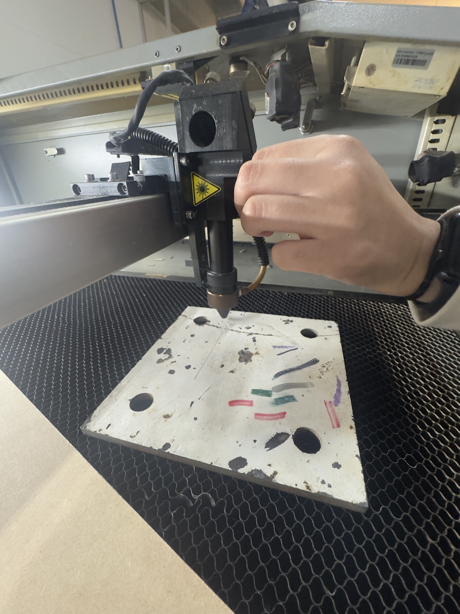

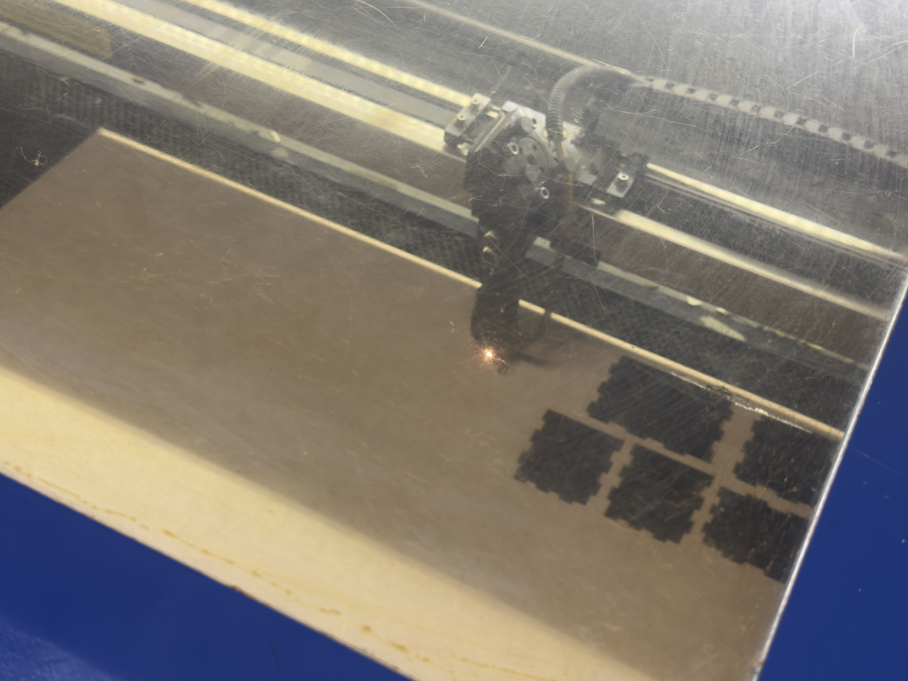

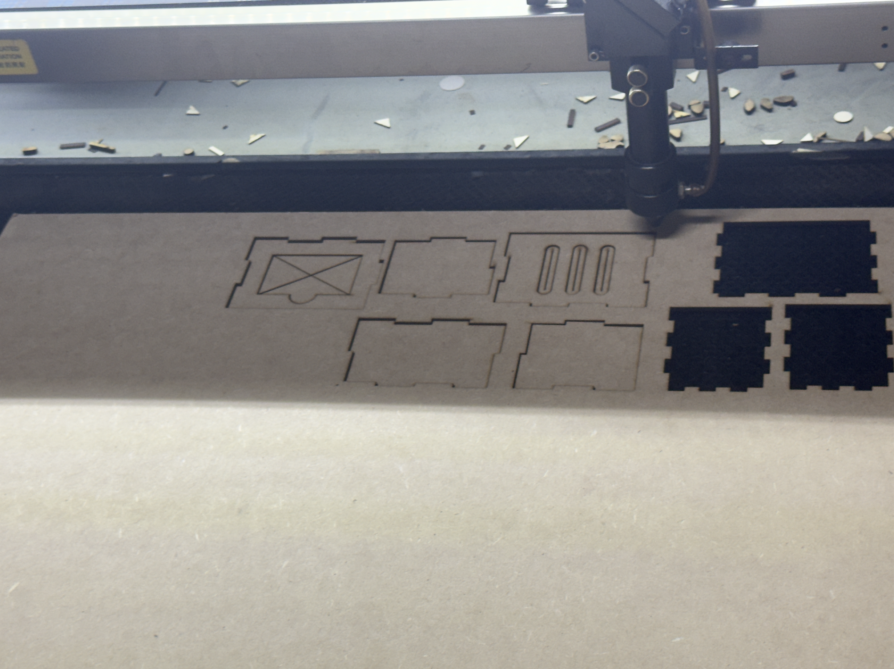

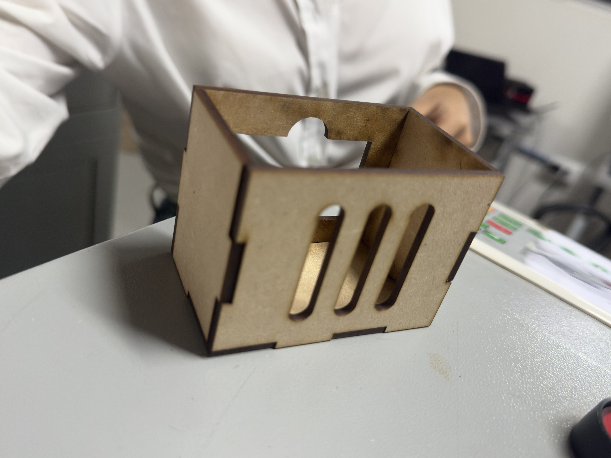

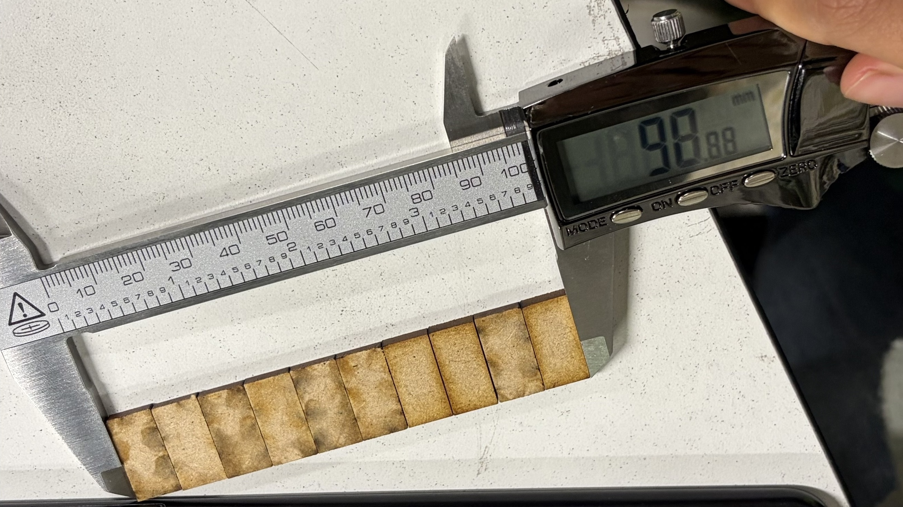

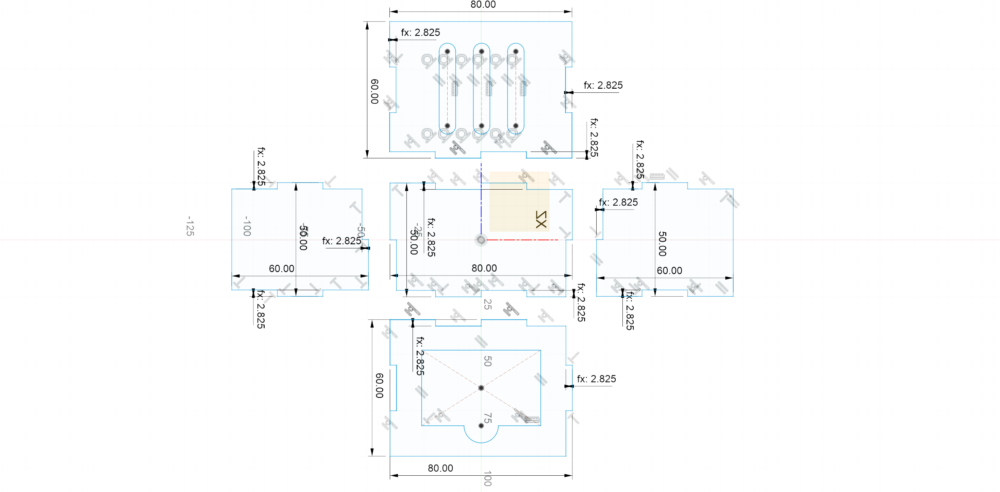

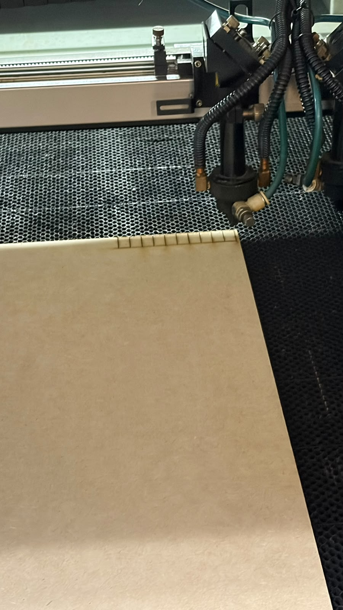

## Declaración de uso de IA

- **Herramienta utilizada:** ChatGPT.
- **Qué le pedí:** Ayuda para organizar la documentación de la fabricación láser según los requisitos de la actividad.
- **Qué modifiqué o rechacé de su respuesta, y por qué:** Se utilizó ChatGPT como apoyo para organizar la documentación del proyecto, elaborar un borrador de fabricacion-laser.md y corregir la redacción y la ortografía del texto. Las medidas finales y los datos experimentales se basaron en las mediciones y pruebas realizadas para el proyecto. Las medidas y la geometría de las piezas fueron realizadas por mí en CATIA y Fusion.